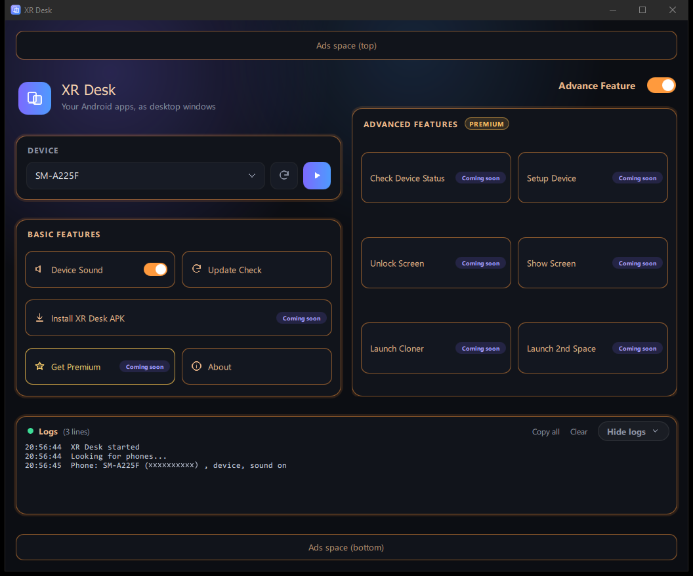
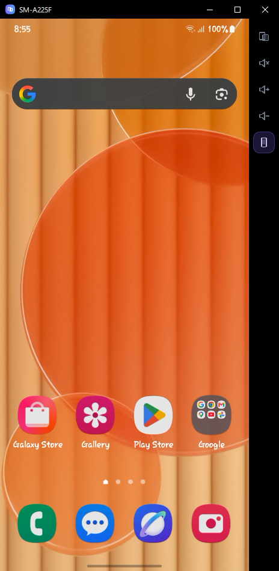
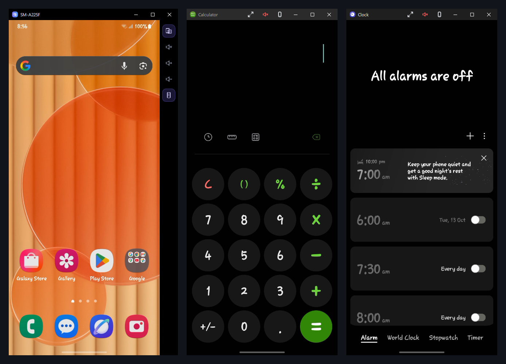
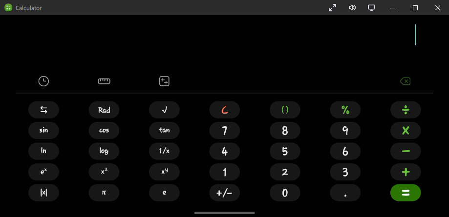

# XR Desk

**Your Android apps, as desktop windows.**

XR Desk shows your Android phone on your Windows PC. Mirror the whole screen, or open each app in its own window, and use your mouse and keyboard. No root, no app to install on the phone: it works over USB debugging.

> **Status: preview (v3.5.0).** The program works; some buttons are marked *Coming soon*. **Download the installer from the [Releases](../../releases/latest) page** (`XRDesk-Setup-3.5.0.exe`).

## Install
1. Download `XRDesk-Setup-<version>.exe` from [Releases](../../releases/latest). Next to it is a `.sha256` file: you can compare it with `Get-FileHash .\XRDesk-Setup-3.5.0.exe -Algorithm SHA256`.
2. Run it. It installs for your user only (no administrator needed) and puts a shortcut in the Start Menu. Everything XR Desk needs (adb, the scrcpy server, Qt, FFmpeg) is inside, nothing else to install.
3. Uninstall it from *Settings > Apps* like any program.

The installer is not code-signed yet, so Windows SmartScreen may warn: *More info > Run anyway* (only for the file from this page).

## What it can do today

**Phone screen on your PC**
- Finds the phones connected by USB and shows their model names. *Refresh* looks again.
- **Play** opens a window with your phone screen. **Stop** closes it. Everything it started on the phone is removed again.
- Mouse and keyboard work on the picture: left button = finger (tap, drag), right button = Back, middle button = Home, wheel = scroll, typing goes to the phone.
- The window keeps the shape of the phone screen, can be resized by its edges, and follows when the phone is rotated.
- Side bar: **Multi window**, **Sound** (the phone's sound on the PC), **Volume up / down**, **Phone screen on / off**.

**Multi window: every app in its own window**
- Switch *Multi window* on, then open an app on the phone. The app moves into its own window on the PC and the phone goes back to its home screen. Open more apps to get more windows.
- Each window shows the app's own name and icon, and has its own taskbar button.
- Close the window and the app is removed from the phone's Recents. Close the app on the phone and its window closes at once.
- Title bar buttons: **Free resize** (preview), **Sound** on / off for this window, **Mobile / Desktop mode** (turns the app's screen between portrait and landscape).

**Sound**
- *Sound* sends the phone's sound to the PC. It is really switched on and off on the phone: when it is off, the phone captures nothing.
- *Device Sound* (main window) switches the phone's own speaker on or off, independent of the PC sound.

**Free version**
- Up to **3 app windows** at the same time for one phone. A fourth app stays on the phone and a popup says so: close an app window to make room. Premium will remove the limit (coming soon).

**Update Check**
- The *Update Check* button opens a small window: it checks this page for a newer version and, if there is one, asks *Download?*. The download shows the percent, how much of the total is done and the speed, then checks the file against its SHA-256. The installer is saved in your Downloads folder; you start it yourself.

**Logs**
- The Logs card at the bottom shows what XR Desk does (phones found, windows opened and closed, errors in red). *Copy all* and *Clear* are there.

## Coming soon
Install XR Desk APK, Get Premium, and the advanced features: Check Device Status, Setup Device, Unlock Screen, Show Screen, Launch Cloner, Launch 2nd Space.

## Connect your phone

1. **Turn on Developer options** on the phone: *Settings → About phone → Software information*, tap **Build number** 7 times.
2. Open *Settings → Developer options* and switch **USB debugging** on.
3. Connect the phone to the PC with a **USB cable**.
4. The phone asks *"Allow USB debugging?"*. Tick *Always allow from this computer* and tap **Allow**.
5. Start **XR Desk**. The phone's model appears in the *Device* list. If it does not, press the **Refresh** button.
6. Press **Play** to see the phone screen. For app windows, press the **Multi window** button in the side bar, then open an app on the phone.

**If something does not work**
- *"(not authorized)"* next to the phone: look at the phone and accept the USB debugging question.
- *"No ready device"*: try another cable or USB port, and make sure the phone's USB driver is installed (Samsung phones: Samsung USB driver). Unplug and plug again, then press Refresh.
- The phone must be **unlocked** when you start. XR Desk never unlocks the phone and never asks for your PIN.
- Windows SmartScreen may warn about a new, unsigned program: choose *More info → Run anyway* only if you downloaded XR Desk from this repository's Releases page.

## Requirements and known limits
- Windows 10 or 11, 64 bit. An Android phone with USB debugging.
- Tested on a Samsung Galaxy A22 with Android 13. Other phones and Android versions are not tested yet.
- **Fingerprint and screen-lock prompts** (and other secure screens, such as some sign-in pages) cannot be shown in an app window: Android draws them on the phone's own screen only. To sign in to an app that needs it, switch *Multi window* off and use the phone screen window.
- The sound is the phone's media sound as a whole, not one app's sound only.
- USB only for now (no Wi-Fi connection).

## Updates
New versions are published on the [Releases](../../releases) page. The *Update Check* button in XR Desk uses it to tell you when a newer version is available. See [CHANGELOG.md](CHANGELOG.md) for what changed.

## Credits
XR Desk uses open-source software: scrcpy (server part, Apache-2.0), Android platform-tools (adb), Qt 6 (LGPLv3) and FFmpeg (LGPL). See [THIRD_PARTY_NOTICES.md](THIRD_PARTY_NOTICES.md). XR Desk is not affiliated with these projects.

## Contact
Questions and feedback: https://t.me/Rakib_tech29/4
